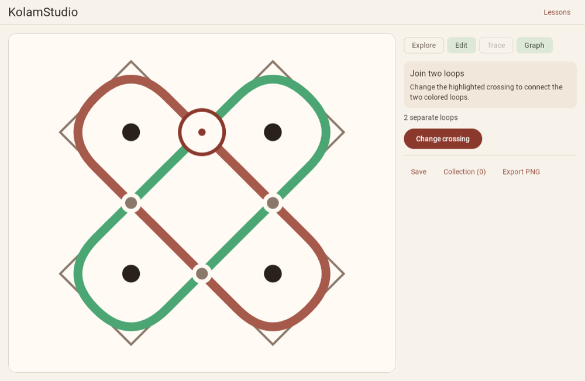

# KolamStudio

KolamStudio is a Kotlin Multiplatform workshop for **sikku kolam**, a South Indian drawing tradition in which lines wind around a grid of dots. Change how two strands meet at a crossing and watch the path split, join, or reroute. Then try drawing the resulting loop in one stroke.



## Try it in your browser

The web build is published at **[avinash-codes.github.io/kolam-studio](https://avinash-codes.github.io/kolam-studio/)**, with no install. Each link below opens straight into a lesson or a shared pattern:

- [Join two loops](https://avinash-codes.github.io/kolam-studio/#lesson/join)
- [Split one loop](https://avinash-codes.github.io/kolam-studio/#lesson/split)
- [Reroute a loop](https://avinash-codes.github.io/kolam-studio/#lesson/reroute)
- [A generated 5 × 5 kolam with two mirror axes](https://avinash-codes.github.io/kolam-studio/#BQUUZAQBAABAEBkU)

The demo was verified in Chrome. It needs a browser with WebAssembly garbage collection (WasmGC).

## Try it in one minute

1. Open KolamStudio. **Join two loops** starts with two colored loops on a 2 × 2 dot grid.
2. Tap the outlined crossing above the center, or press **Change crossing**. The horizontal mirror joins the two loops into one. **Undo** restores the crossing. **Graph** toggles the underlying paths and mirrors.
3. Press **Trace this loop**. Start at the marker and drag along the line until you return to the start. **Start again** resets the trace.
4. Use **Save** and open **Collection** to reopen or rename the pattern. **Export PNG** downloads or saves a clean image. On Android and iOS, open **Export** for **Save PNG** and **Share PNG**.

**Lessons** also has examples for splitting a loop and rerouting it. **Explore** generates new single-loop patterns, with grid dimensions and symmetry under **Grid settings**. To transfer an editable pattern between devices, copy **Current pattern code** from Collection, paste it into Collection on the other device, and press **Import**. On the web, the address bar also carries the current lesson or exact pattern. The collection is saved locally on each device or browser.

## Run from source

Install a [Zulu JDK 21](https://www.azul.com/downloads/?version=java-21-lts&package=jdk), and make `java -version` available in your terminal. The Gradle wrapper pins Gradle 9.6 and a Zulu 21 daemon. Allow internet access for the first dependency download. The commands below assume a shell in the repository root. On Windows, run Gradle commands with `gradlew.bat` in Command Prompt.

```sh
git clone https://github.com/Avinash-Codes/kolam-studio.git
cd kolam-studio
```

### Web (Wasm or JS)

```sh
./gradlew :webApp:wasmJsBrowserDevelopmentRun
```

Open [the local Join lesson](http://localhost:8080/#lesson/join). To run the JS build, stop the Wasm server with `Ctrl+C` and run `./gradlew :webApp:jsBrowserDevelopmentRun`, then open the same URL. Both use WebGL and the Skiko rendering engine. The Kotlin/Wasm build also needs WasmGC. Both were verified in Chrome 157. Gradle downloads Node and Yarn for the build.

### Desktop (JVM)

```sh
./gradlew :desktopApp:run
```

Run from a graphical session. Verified on macOS arm64. `./gradlew :desktopApp:hotRun --auto` is an optional development command that provisions JetBrains Runtime.

### Android

Install [Android Studio](https://developer.android.com/studio). In SDK Manager, install **Android SDK Platform 37** and **Android SDK Platform-Tools**. Create and start a virtual device in Device Manager, or connect a device with USB debugging enabled. The app targets API 37 and requires API 24 or later.

Set `ANDROID_HOME` to the SDK location shown by SDK Manager. For example, on macOS:

```sh
export ANDROID_HOME="$HOME/Library/Android/sdk"
export PATH="$ANDROID_HOME/platform-tools:$PATH"
adb devices
./gradlew :androidApp:installDebug
adb shell am start -n com.avinash.kolamstudio/.MainActivity
```

Use one emulator or device for these commands. With multiple devices, target an emulator by setting `ANDROID_SERIAL` to the serial from `adb devices`. Alternatively, `./gradlew :androidApp:assembleDebug` writes `androidApp/build/outputs/apk/debug/androidApp-debug.apk`.

### iOS

On an Apple Silicon Mac, install Xcode and an iOS Simulator runtime **18.5 or later**. Open Xcode once to install its components. Open the project, select the **iosApp** scheme and an iPhone simulator, then press **Run**.

```sh
open iosApp/iosApp.xcodeproj
```

The simulator needs no signing team. The Xcode build runs Gradle to build the shared framework. Verified with Xcode 27.2 on an iOS 27.2 arm64 simulator.

## Tests and implementation

```sh
./gradlew check
./gradlew ktlintCheck
```

`check` runs the shared tests for the available targets, ktlint, and Android Lint. Install Chrome for browser tests. Run `./gradlew :shared:iosSimulatorArm64Test` on an Apple Silicon Mac for the iOS test run. The shared tests exercise generation, loop traversal, the three lessons, tracing, pattern codes, and collection persistence. CI also builds both production browser bundles and checks the same first lesson, saved-pattern reload, and PNG download in both.

The grid model, generator, graph traversal, editor, lessons, drawing and export, persistence, and Compose UI live in [`shared/src/commonMain`](shared/src/commonMain). The platform source sets provide app entry points, file dialogs, native image sharing, and web links. Pattern codes pack dimensions and midpoint states, so importing a code recreates the drawing without a server.

### Shared code

**89.6% of the app's source lines are shared**: 1,453 non-blank lines of Kotlin in `commonMain`, against 168 lines of platform code across all four targets (Kotlin plus the iOS app's Swift). All 291 lines of tests are shared too, in `commonTest`. To measure it yourself:

```sh
count() { find "$@" -type f \( -name '*.kt' -o -name '*.swift' \) -print0 | xargs -0 cat | grep -cv '^[[:space:]]*$'; }
count shared/src/commonMain
count shared/src/androidMain shared/src/iosMain shared/src/jvmMain shared/src/webMain androidApp/src desktopApp/src webApp/src iosApp
```

## License and artwork

[Apache License 2.0](LICENSE). The launcher icons, favicon, and lesson patterns are project-created artwork based on the same dot-and-loop geometry used by the app. The screenshot shows the running app. The UI uses system fonts. For background on the art form and its topology, see [A Topological Approach to Creating any Pulli Kolam](https://arxiv.org/abs/1503.02130).
